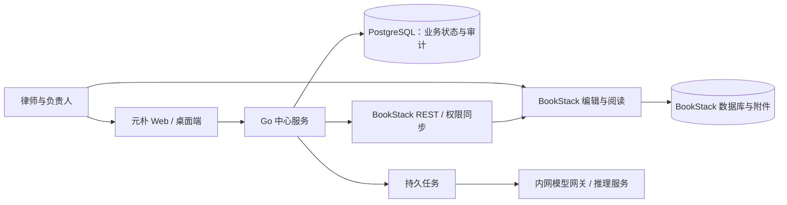

# 律所知识沉淀平台技术设计

来源：2026-10-15《律所知识沉淀平台 技术设计文档》。本文将原稿中缺失的嵌入图改写为文字流程，并结合元朴中心已确定的身份、部署和工程边界，作为律所行业包的设计基线。**本文描述目标方案，不表示所有模块已经上线。** 当前实现、缺口和验收顺序见[落地与验收清单](todos/legal-knowledge-platform.md)。

## 1. 目标与边界

平台先服务本所内部的知识沉淀，再作为私有化产品交付其他律所，最后用行业包扩展到其他行业。要解决的是办案经验、裁判观点和合同范本分散，重复检索与踩坑，以及敏感材料无法交给公有云或外部模型的问题。

个人在本地使用 LLM 整理、脱敏办案材料，向团队提交标准化条目；中心 Agent 辅助校验、归类、相似检索、合并和冲突提示；领域负责人审核并决定发布；系统定期生成简报和专题手册。Agent 的结论是待审稿，不自动成为团队共识。

| 阶段 | 目标与验收方向 |
| --- | --- |
| 内部试点 | 一个业务组完成从提交、审核到检索复用的闭环；持续统计提交量、审核量和复用量。 |
| 全所推广 | 案件级权限与利益冲突隔离墙经过拒绝测试，所有律师按授权使用。 |
| 私有化交付 | 同一套安装包在另一家律所部署，客户配置与行业包独立于核心代码。 |
| 多行业 | 增加第二个行业包，不修改通用业务核心即可运行。 |

首版不建设案件管理系统，不替代法律数据库，也不承诺自动生成正式法律文书；案件、客户和法规引用在本平台中仅服务于知识治理、权限与追溯。

## 2. 已确定的架构决策

| 领域 | 元朴落地口径 |
| --- | --- |
| 工程边界 | 继续使用本仓 `server/backend` Go 单体、`server/web` 站点、`apps/desktop` 桌面端和现有 SDK；不另建服务仓库。律所规则放入 `server/backend/industries/legal`。 |
| 展示与编辑 | BookStack 是可替换的律所知识展示、编辑层，经 `internal/store/bookstack` REST 适配器连接；不修改其源码。元朴中心的资讯与 AI 能力目录仍由现有 Web 站点承载。 |
| 业务与权限 | Go 服务持有行业规则、提交状态、审核、案件和隔离墙的最终事实，计算权限并同步到 BookStack；直接从 BookStack 访问内容时也必须满足同步后的权限。同步失败应拒绝敏感内容的发布或读取。 |
| 数据 | Go 使用 PostgreSQL；BookStack 使用独立的 MariaDB/MySQL 兼容数据库与附件卷。新律所业务表预留 `org_id`，首版按单组织运行。客户之间按独立部署隔离。 |
| 异步任务 | 流水线与导出使用可恢复、可重试、可幂等的持久任务。原稿建议 Redis 和 asynq/River，具体实现待队列纵切时定型；首版不因建议选型再造第二套状态源。 |
| 模型 | 所有模型任务经 Go 网关，默认只允许内网的 OpenAI 兼容推理服务。关联案件的资料禁止发送到外部模型。 |
| 交付 | 一个客户一套私有化部署；Compose、配置、行业包、数据库和附件备份一起交付。生产入口使用 HTTPS 与内网/VPN。 |

原稿提出 LDAP/OIDC 统一登录，现阶段的**实际产品决策**是：普通浏览器以账号密码进入个人中心；yuanpu-agent 内嵌浏览器首次以账号密码登录，中心签发设备 API key 并由桌面受限桥接保存，后续凭 Key 无感进入元朴中心。桌面浏览器标识只决定页面流程，不能充当认证凭据。BookStack 的浏览器无感登录需要单独设计身份映射与 SSO；不能把中心 API key 直接暴露给 BookStack 前端。若将来客户需要 LDAP/OIDC，作为中心与 BookStack 的扩展接入，而不是首版前置条件。

组件关系如下；图中的 BookStack 接入和行业流水线是目标架构，当前落地范围见[清单](todos/legal-knowledge-platform.md)：

## 3. 知识流水线

原稿的“十步、三分支”架构图未随 Markdown 导出。下面按其正文还原成可验收的十步，导出任务独立于单条发布流程：

1. 作者在个人工作区整理材料、脱敏，选择知识类型并填写来源、置信度、适用限制等字段。
2. 作者将条目提交到 BookStack 系统书架的收件箱；Go 保留原始页 ID、作者、来源和提交时间。
3. BookStack Webhook 触发采集；定时轮询补漏。Go 重新拉取原页并以提交 ID/版本执行幂等处理，不信任回调正文。
4. 行业包验证通用字段、类型必填字段、段落与引用格式，缺项退回作者。
5. Agent 复查脱敏；疑似敏感信息退回作者确认，不能仅凭“已脱敏”勾选放行。
6. Agent 依据分类体系归类，并在当前操作者获授权的范围内检索相似条目。
7. Agent 生成新条目或合并建议，保留每段结论的原文、作者和来源链接。
8. Agent 标注与现有结论的冲突，抽取并核验原文中的法规和案号；冲突或未核验引用附说明进入人工审核，不自动裁决。
9. 领域负责人审查、修改或退回，记录决定、意见和版本；只有有权的人可以批准发布。
10. Go 幂等发布到 BookStack 正式章节，回链原始提交，把原页归档到“已处理”；写入审核和状态审计。失败重试不能产生重复正式条目。

主要分支为**字段/脱敏不合格退回**、**审核驳回或要求修改**、**冲突/引用待核验并交人工裁决**。建议状态为 `received → validated → processed → pending_review → published`，异常终态或等待作者动作使用 `rejected`、`returned`；每次转换写只追加审计。状态推进必须以持久任务和版本/幂等键约束，不能靠 BookStack 页面的移动位置推断。Webhook 丢失时按原稿每 30 分钟轮询收件箱；周报按周生成，专题手册按需生成，并保留当时引用来源及权限水位。

## 4. 律所知识模型

律所行业包定义六种类型，字段规则由 Go 校验，其他行业更换行业包：

| 类型 | 用途 | 特有必填字段 |
| --- | --- | --- |
| 办案经验 | 案件策略、难点与实践经验 | 案由、审级、地域 |
| 裁判观点 | 争议点与法院裁判倾向 | 争议点、案号列表、法院层级 |
| 合同范本 | 已验证的条款与适用说明 | 合同类型、适用场景、风险提示 |
| 法规解读 | 法规要点及业务影响 | 法规名称、条文编号、生效日期、时效状态 |
| 检索报告 | 特定法律问题的研究结论 | 研究问题、检索范围、截止日期 |
| 流程指引 | 立案、保全、执行等操作 | 适用法院或机构、更新日期 |

每条知识均须有标题、类型、作者、提交日期、业务领域、原始来源、置信度、脱敏确认和“适用范围与限制”；关联案件可选。正文固定为“一句话结论、背景、要点、法规与案例引用、适用范围与限制”。没有引用时明确写“无”，不能把模型补出的法条或案号当作来源。原始来源和置信度缺失时拒绝入库；关联案件的条目继承案件级可见范围，不关联案件的条目仍受领域范围控制。

现有行业包在 `server/backend/industries/legal`，包括 `industry.yaml`、`taxonomy.yaml`、`redaction.yaml`、`checks.yaml`、六份模板和提示词目录。现有 `GET /v1/industry`、`GET /v1/industry/templates/{type}`、`POST /v1/industry/validate` 只完成**提交前规则与字段校验**，不等于原文真实、脱敏复查或发布已经完成。

## 5. 权限、案件与隔离墙

授权维度为“角色 × 内容范围 × 动作”，角色和动作配置由 Go 中心管理；服务端依资源事实计算，BookStack 实体权限只是其中一个执行点。

| 角色 | 允许范围 |
| --- | --- |
| 系统管理员 | 管理用户、行业配置和空间；日常管理身份不默认获得案件正文阅读权。 |
| 合伙人/领域负责人 | 审核并发布负责领域的条目，在案件授权和隔离墙约束内管理领域权限。 |
| 律师/贡献者 | 提交条目、编辑自己的草稿、阅读授权范围内的已发布内容。 |
| 助理/只读成员 | 阅读授权范围内的已发布内容。 |
| `kb-agent` | 读取明确授权的收件箱和知识，只能写待审核稿，不能发布，也不能访问敏感空间。 |

BookStack 的书架映射业务领域，书映射主题，章映射知识类型，页映射单条知识；另设系统书架容纳收件箱、待审核、已处理和导出。Go 维护客户、案件成员及利益冲突名单。关联案件的内容只对案件团队及获准的领域负责人可见；被列入某客户隔离名单的成员，即使是领域负责人也不可见。判断优先级为**隔离 > 案件授权 > 领域授权 > 默认可见**。隔离名单增删要求两人确认并留痕。

管理员在 Go 后台调整案件成员、隔离名单或领域负责人后，Go 计算 BookStack 书/章/页权限，通过[内容权限 API](https://demo.bookstackapp.com/api/docs)写入实体 ACL；夜间全量比对，发现漂移就恢复并告警。列表、搜索结果、摘要、详情、附件、导出和模型 Context 均执行同一授权规则；撤权后旧缓存和导出链接也必须失效。BookStack 的[默认管理员角色可见全部内容](https://www.bookstackapp.com/docs/user/roles-and-permissions/)，不能直接承担“日常管理员不可见案件”的要求；应使用受限日常角色，最高权限凭据单独托管并审计。完成真实实例的拒绝测试前，不向 BookStack 导入敏感案件材料。

## 6. Go 模块与数据

第一阶段保持单体服务，模块通过内部接口协作。模块是逻辑职责，不要求现在就按原稿示意另建 `kb-server`：

| 模块 | 职责 | 阶段 |
| --- | --- | --- |
| `org` | 律所、部门、成员、角色及身份映射 | 一 |
| `industry` | 行业包、模板、分类与字段规则 | 一 |
| `store/bookstack` | 页面与权限 REST 适配、连接探针 | 一 |
| `acl` | 领域权限计算、同步与漂移比对；案件权限后续接入 | 一、二 |
| `pipeline` | 收件、校验、脱敏复查、整理和待审稿 | 一 |
| `review` | 审核任务、发布、退回与版本追溯 | 一 |
| `llm` | 内网模型网关、用途路由、限流与调用元数据 | 一 |
| `export` | 周报、专题手册与新人包 | 一 |
| `matter`、`wall` | 客户、案件成员、隔离名单与双人确认 | 二 |
| `citation` | 法规/案号核验和法规时效巡检 | 二 |
| `audit` | 跨组件访问、修改、发布、权限和模型调用审计 | 一起步、二报表 |

Go 自有 PostgreSQL 至少需要组织与用户映射、客户、案件及成员、隔离名单、提交、正式条目及版本、引用、审核、审计、模型调用等数据域。关键关联包含 `org_id`、BookStack 用户/页面 ID、原始提交 ID、案件 ID、作者/审核人、版本和幂等键。BookStack 的页正文不应成为审核状态和授权来源的唯一事实。表结构以迁移文件与 OpenAPI 为准，原稿中的表名是目标模型，不表示现有数据库已建齐。

## 7. 模型、引用与产物

推理服务可用内网 vLLM 或 Ollama 的 OpenAI 兼容接口；网关按归类、合并、脱敏检查等用途路由模型。向量检索只在获授权的候选集合内运行，结果再次做权限过滤。配置默认禁止外部 API；关联案件资料始终禁止外发。试点时实测中文法律材料的质量、延迟和硬件成本，再确定模型与两档交付规格。

Agent 可做格式检查、疑似敏感信息定位、归类、相似检索、合并建议、冲突提示和引用抽取。它只允许引用原始提交或获授权的现有条目中出现的法规与案号；引用模块对照本所法规清单或已采购的数据源核验，无法核验的引用明确标记给审核人。每段合并结论保留来源。法规引用记录名称、条文、版本日期和“现行有效/已修订/已废止”等状态；每周巡检，变化时标记受影响条目并通知负责人。法规状态数据源尚未确定。

模型调用审计记录用途、模型、时延、Token 用量和输入摘要哈希，不在普通运行日志中保存原始敏感材料。周报、专题手册与新人包只能从当时有权读取的已发布条目生成，产物本身继承源内容中最严格的权限。

## 8. 安全、审计与运维

审计覆盖登录、阅读、搜索、编辑、提审、审核、发布、驳回、导出、权限和隔离名单变更，以及每次模型调用。Go 审计记录只追加，保留期限按客户配置，支持按人、案件和时间查询导出。BookStack 的阅读/编辑事件如何完整采集需要在真实实例上验证；不能假定 Webhook 能覆盖每一次查看。

桌面运行日志与业务数据走分开的接口：`POST /v1/logs` 接收结构化操作元数据，`POST /v1/data-uploads` 接收数据文件，`GET /v1/data-uploads/{id}` 按权限下载。现有纵切只提供基本接口和上传者隔离；正式交付还需文件扫描、对象存储/加密、附件级授权、保留与删除策略，以及桌面端调用。日志不得夹带会话正文、凭据或个人脱敏映射。

全站使用 HTTPS，仅允许内网或 VPN 访问。BookStack API Token 留在服务端，最小授权并定期轮换；模型服务只监听内网。数据库与附件卷须落实静态加密及密钥管理。Go/PostgreSQL、BookStack 数据库和附件卷一起备份；原稿的目标是每日备份并保留 30 天、每周异地备份、每季度恢复演练。生产交付需在客户环境实际验证备份恢复、升级兼容、权限同步失败和令牌撤销。当前 `server/backend/deploy/compose.bookstack.yaml` 是可选 BookStack 接入入口，不是完整生产交付包。

## 9. 产品化与行业包

行业包包含知识类型与必填字段、分类、六类提交模板、脱敏规则、Agent 提示词和行业特有校验。新增医疗或咨询行业时先复制同结构行业包，再用第二个行业完成“核心不改”的端到端验证；仅创建配置目录不足以证明多行业能力。

每位客户独立部署 Go、PostgreSQL、BookStack、其数据库与附件、任务队列和模型服务。交付物为版本固定的安装包、行业包、部署/恢复手册及依赖许可证清单。品牌标识、配色与文案由展示层配置/主题处理，不写入 Go 核心。BookStack 源码按其[MIT 许可证](https://github.com/BookStackApp/BookStack/blob/development/LICENSE)使用并保留许可声明；容器镜像、模型和其他依赖分别登记与复核。BookStack 升级先在测试环境验证 API、权限映射、页面和附件行为。容量或编辑体验无法满足要求时，可利用存储适配层替换展示端，Go 业务规则与业务数据库继续保留。

客户授权文件、席位和到期只读是原稿提出的商业化方案，尚非现有服务能力；进入交付阶段再确定具体策略及断网、时间回拨和升级行为。

## 10. 阶段交付与待确认事项

| 阶段 | 交付门槛 |
| --- | --- |
| 一：业务组试点 | BookStack 身份映射、领域权限、收件箱与待审稿、人工发布、来源追溯、内网模型网关、基本审计和周报；一个业务组完成真实纵切。 |
| 二：全所推广 | 案件成员、隔离墙双人确认、读/搜/附件/导出同判、引用核验与时效巡检、审计报表和权限规模测试。 |
| 三：私有化产品 | 同版安装与升级、HTTPS、密钥轮换、备份恢复、运行手册、客户环境验收和许可证清单。 |
| 四：多行业 | 第二个行业包完成提交到发布的验收，核心逻辑不为该行业增加特殊分支。 |

原稿估计前两个阶段约六个月，具体周期需要在试点团队、开发人力、模型资源和外部数据源确定后重估。主要风险与对应验证：律师投稿不足时观察结案复盘转化率；模型质量不足时统计人工修改率；脱敏遗漏与引用幻觉用审核抽样和拒绝测试把关；BookStack 权限规模与版本升级通过压测和集成测试验证；硬件成本用真实材料做分档基准。

尚需业务方确定：试点业务组与领域负责人、法规时效数据来源、推理服务器预算、审计保留期限，以及客户是否要求接入 LDAP/OIDC。技术上还需验证 BookStack 浏览器 SSO、阅读审计、实体权限规模和失败时的拒绝行为。实施状态和逐项验收以[落地与验收清单](todos/legal-knowledge-platform.md)为准。
