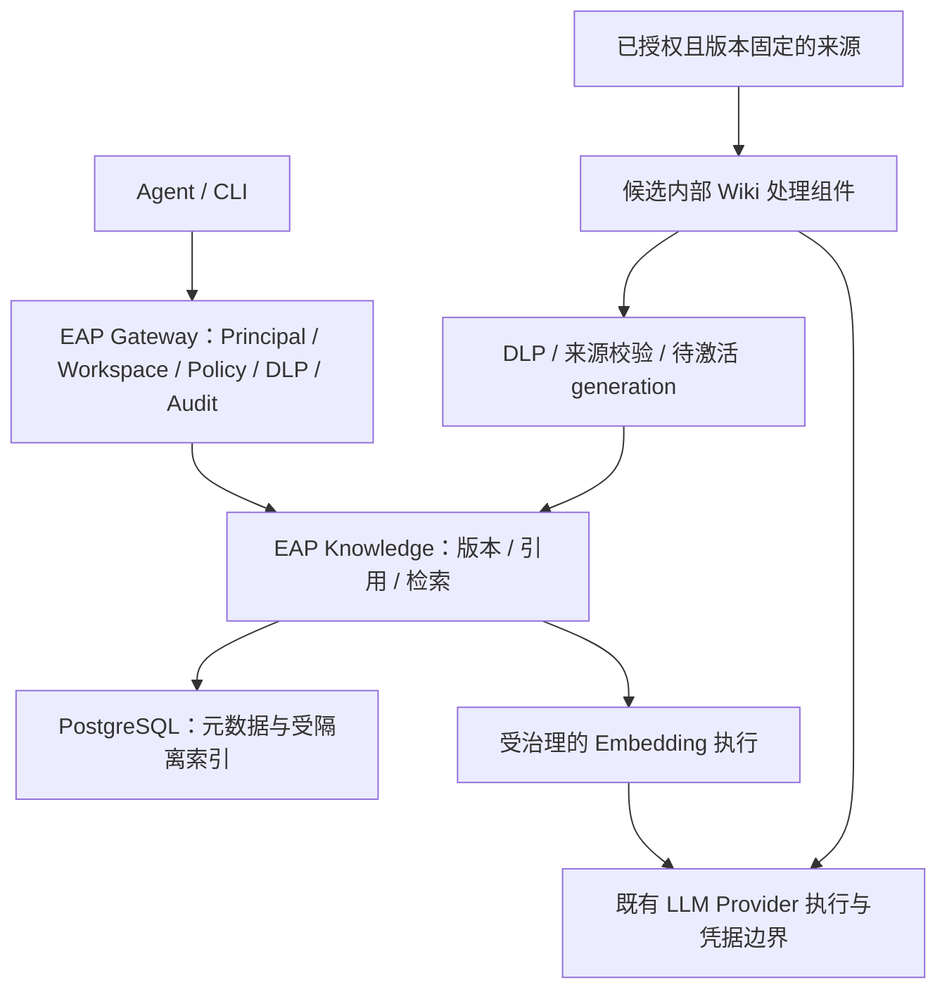

# TencentDB-Agent-Memory 融合设计与任务交接

日期：2026-09-25。性质：规划与 TASK-056 已接受设计契约；生产实现/接入仍须各自门禁。用户已授权按卡开发；本卡只冻结文档/fixture/评测，不修改生产实现。

TASK-056 评审入口：[ADR-0029](../adr/0029-knowledge-retrieval-generations.md)、[请求/响应及治理实况](contracts.md)、[钉版与后续接缝](reuse-and-handoff.md)、[固定评测与 Hash 基线](eval/README.md)。下文“拟采用”条款由这些契约文档具体化；ADR-0029已对a10de92经独立Sol审查接受，任务仍由integration writer集成完成；后续卡还须满足全部实现依赖。

任务状态唯一来源：[tasks.yaml](tasks.yaml)。全局边界：[架构边界](../../.tasks/architecture.md)。本设计补充近期可执行的知识增强路径；企业记忆的产品优先级以 [PRD](../01-PRD.md) 为准。

## 目标与范围

让员工通过现有 EAP 凭据和 Workspace 找到相关文档、获得可追溯引用，并在可控条件下复用 TencentDB 的知识处理能力。分三条线推进：

- 检索增强：受治理的语义向量、按 Workspace 隔离的关键词与向量融合、模型或索引切换时的一致性。
- 知识引擎：同时验证 Wiki 与 CodeGraph 的拆分成本；首个生产候选切片是 Wiki 派生文档进入 EAP 检索。CodeGraph 图查询保留为实验结论，不在首个生产切片中隐式新增图数据库或公共协议。
- 企业记忆：设计 Working Memory 的权限、生命周期与知识候选晋升，交付评审稿和后续任务建议；本轮没有企业记忆生产实现卡。

本轮不安排 Portal 新页面，不启动第二套身份、Skill Registry、Agent Runtime、MemoryProxy 或全量会话采集。

## 即时撤销架构前置（复审发现，2026-09-25）

冻结知识检索与复用契约（TASK-056）的独立审查发现：当前 Key 吊销已在同一事务写入 `api_keys.revoked_at` 与可靠审计，新请求会在 `requireAPIKey` 被拒；但已鉴权的 LLM SSE 与 MCP 工具调用可以在吊销完成后继续输出或执行。Knowledge 自己增加发送门禁不能代表 PRD §12.6 所说的“所有 Agent 能力立即不可访问”。该轮候选当时保持proposed；后经TASK-064/ADR-0030决策、共享owner交接及a10de92独立复审，ADR-0029现仅在设计层接受；上述发现仍是运行缺口，不因设计接受而消失。

全平台即时撤销与在途执行边界（TASK-064）先完成独立安全架构评审，决定已有 `DELETE /enterprise/v1/keys/{keyID}` 204 完成点、跨实例在途取消/响应释放、外部副作用与失败恢复的契约。实施全平台撤销后的在途能力阻断（TASK-065）按接受的契约修改共享 Gateway/identity/store 接缝。受治理的语义向量入库与版本切换（TASK-057）须同时消费 TASK-056 和 TASK-065 的结果，不能在 Knowledge 内另造一套较弱撤销语义。若产品明确把 PRD 限定为“仅新请求即时拒绝”，应先更新 PRD 与任务依赖，再复审 ADR-0029；本提案尚未获得这种变更。

当前部署以 `eap` 高权限 PostgreSQL 账号同时迁移与运行 Gateway。ADR-0029 如要求触发器强制串行治理写入，TASK-057 必须拆分迁移/owner 与最小权限运行账号，并在启动时验证运行账号无禁用触发器能力；否则不能把触发器当作安全边界。

## 已核实事实

| 事实 | 本地证据与影响 |
| --- | --- |
| EAP 基线为 `0658a30ad0cda2267b8d4d728de356656514e7f4`，当前分支 main | 历史任务完成证据复用；本轮规划不重写历史状态 |
| 参考仓库基线为 `828ac8907ccde2cfed14ca42acd0420bea19e409` | `../../../TencentDB-Agent-Memory/LICENSE` 标明 MIT；实际引入文件仍须核对依赖及归属，不将根许可证推及全部依赖 |
| EAP Knowledge 已有上传、DLP 和带引用检索 | [路由](../../apps/gateway/server.go)、[处理器](../../apps/gateway/knowledge.go)、[垂直切片决策](../adr/0012-knowledge-slice.md) |
| EAP 生产注入 HashEmbedder；向量为 SQL 数组，Workspace 内计算余弦 | [装配](../../apps/gateway/main.go)、[实现](../../packages/knowledge/knowledge.go)、[表结构](../../migrations/000007_knowledge.sql)；不能将开发计划里的混合检索视为运行事实 |
| 当前数据库镜像为 postgres:16-alpine，尚未装配 pgvector | [部署](../../deploy/docker-compose.yml)；扩展、镜像钉版、迁移和旧数据处理均属于实现卡 |
| Embedder 仅接受文本与 context，公共 embeddings 路由直接调用协议客户端 | [Embedder](../../packages/knowledge/knowledge.go)、[协议处理器](../../apps/gateway/protocols.go)；不能假定复用这个客户端就已获得完整 Policy、DLP、Usage、Audit 治理 |
| TencentDB MemoryCore 包含 L0–L3、Skill 与资产元数据；默认单机 SQLite、本地文件与进程内状态 | `../../../TencentDB-Agent-Memory/MemoryCore/README.md`；不将其 Team/User/Agent 元数据设为 EAP 权威来源 |
| TencentDB 有独立 RRF 排序实现 | `../../../TencentDB-Agent-Memory/MemoryCore/src/core/store/search-utils.ts`；可借鉴排序方法，存储实现需适配 EAP |
| MemoryKnowledge 使用 Wiki/CodeGraph 引擎、SQLite、Panel 回调和 LLM binding | `../../../TencentDB-Agent-Memory/MemoryKnowledge/README.md`；能否脱离 Panel 形成有限处理组件需要实验证据 |
| Knowledge 只读 API 在启用服务密钥后仍有鉴权白名单，租户 ID 由调用方提供 | `../../../TencentDB-Agent-Memory/MemoryKnowledge/src/middleware/auth.ts`、`src/routes/tools.ts`；不能直接成为 EAP 员工入口 |
| v3 memory router 对必填隔离字段做校验，与用户凭据绑定仍是不同问题 | `../../../TencentDB-Agent-Memory/MemoryCore/src/gateway/v2-router.ts`；以运行代码为准，不沿用 API 文档中 default 桶的矛盾描述 |

检索记录：前序对两个绝对仓库路径的 ZG 架构查询均返回 INDEX_MISSING；未创建索引。随后按 PRD、Knowledge、Gateway、鉴权、Store、Pipeline 等已知锚点限定 rg 和文件读取；本轮复用这些证据并核实任务、部署与验证入口。

## 拟采用边界

图中的内部 Wiki 组件是生产接入候选，只有实验证明可复用并完成架构评审后才允许装配。其模型调用必须经过同一治理服务接口，图中箭头不表示直接获取 Provider 密钥。

### 检索契约

冻结知识检索与复用契约（TASK-056）负责冻结下列契约，后续实现共同消费：

1. 保留 `POST /enterprise/v1/knowledge/documents` 与 `/search` 的既有请求及引用字段。`score` 的算法从 cosine 切至融合排序需明确其非概率语义、兼容影响和测试；新增来源字段按协议规则评审。
2. Principal 和 Workspace 来自服务器鉴权结果。模型选择、存储查询、索引重建与后台任务不得从任意 body/header 自行建立权限。Background job 绑定来源、Workspace、操作者和受限服务身份，重试时重新验证仍有效的授权。
3. embedding generation 记录模型身份、模型版本或可验证配置摘要、维数、预处理版本。查询向量与文档向量必须同代际；同维数也不能跨模型混用。模型路由变更不得静默更换向量空间。
4. 新版本与新 generation 在构建区完成后原子激活。首次构建失败不可检索；替换构建失败保留旧活动版本；成功替换后旧版本立即不可检索。先调用受限远程模型，再用短事务落库和激活，避免持有长事务等待网络。
5. 向量与关键词候选在 SQL 查询阶段限制 Workspace、有效文档版本和活动 generation。ACL 未解析成功时不取内容。索引缓存必须包含这些维度；成员资格和 Key 有效性逐请求验证。
6. 关键词初选采用 PostgreSQL 原生全文索引/排名，明确中文分词或现有 CJK token 方法；原生 `ts_rank` 不称为 BM25。向量与关键词用 RRF 融合、按 chunk 去重并确定性排序；不为追求 BM25 另引入搜索服务或扩展。
7. 首版选用 PostgreSQL/pgvector 内的精确、有 Workspace 谓词的候选检索；ANN 为后续优化，避免把全局 ANN top-k 后过滤当作隔离。pgvector 镜像和版本由契约卡根据现有 PG16 兼容性选定并钉版，不在本提案中虚构可用版本。
8. 默认不在检索时自动降级至另一 embedding 模型。模型不可用明确失败，已有索引不被破坏；若后续增加关键词降级，需显式契约和可观测状态。HashEmbedder 保留为显式离线/测试模式，与生产 generation 分开。

### 治理与可靠性

知识上传、检索和模型调用需要可执行的共同治理入口。已有 handler 中出现 DLP 检查不能替代完整 Policy 与审计链证据。受治理的语义向量入库与版本切换（TASK-057）负责补齐本切片实际缺口，并建立相关回归；门禁卡不承担修复。

- 入库前扫描、模型 egress 前扫描、返回引用前按当前规则扫描均有效；入库时已扫描不免除后续规则变化后的检查。不得因调用者可查看原文而向外部模型发送原文。
- 模型动作沿用现有 Policy 决策语义，包括 local-only、redaction、approval 和 deny；缺乏可执行审批续接时明确阻断。
- 员工 key 只在 EAP 入口消费；如存在进程间调用，接收方验证明确 audience 的短期内部身份。Provider 密钥使用现有服务端引用解析，不由客户端或 Wiki 自建配置提供。
- 读写、拒绝和发布结果走可靠审计；审计不可用不得返回成功内容或激活未审计的新版本。审计与变更的原子关系、外部调用前的持久授权记录以及调用后失败的恢复语义须在契约卡明确。
- Usage 记录模型与 Workspace 归属，缺失实际 token/价格标为未知，不将零值当作已知用量；远程成本与检索延迟分别观测。审计和日志不保存原始文档、会话、Query 或 Provider 密钥。

### Wiki 与 CodeGraph 的采用门槛

Wiki/CodeGraph 内核拆分验证（TASK-060）在 EAP 内隔离实验目录操作钉版副本，参考仓库只读。它可独立于仍待审的 Knowledge 契约进行，因为仅验证源码拆分、受控输入和适配成本；实验不得把候选接口当作生产契约。验证输出是证据与 go/no-go 决策，不自动批准生产部署。

该实验已在 main 完成；[engine-spike.md](engine-spike.md) 记录固定输入、来源引用、更新/删除、伪造隔离字段与许可样本。当前生产采用结论为 **NO-GO**：上游 Wiki 文件提交路径实测可经符号链接读取并覆盖根目录外文件，受控 adapter 也未封闭这个路径；真实模型效果和 native 包分发许可仍未核实。封闭 Wiki 候选文件读写边界（TASK-066）单独处理该已证实缺陷并复核安全资格。Wiki 派生文档接入 EAP（TASK-061）继续保持 `needs_arch_review`，仍需独立生产采用决定。

首个生产候选为 Wiki 派生文档接入 EAP（TASK-061）：一个受控文本资料源生成页面，再进入同一 Knowledge 引用与检索链。开始该卡前必须有接受的 ADR，明确组件部署、内部认证、字段映射、存储归属、任务恢复和许可材料。该卡设为 needs_arch_review；即使实验卡完成也不能自动解锁。否决采用是合法实验结果，应记录原因并通过后续架构处置撤销或重写生产卡及其门禁，不能假定已有采用决定。

拟冻结的内部作业输入为服务器生成的 Workspace、SourceID、SourceVersion、内容摘要、授权上下文和预算；输出为派生页面、来源片段与源版本。页面生成属于带标识的派生资料，不自动获得 Canonical Knowledge 的审核状态。引用应追溯原始来源，不能只引用模型生成页。

PostgreSQL 保存权威来源、权限和活动版本，MinIO 在需要原文件时保存原件。临时 SQLite/文件只能作为可重建的内部计算状态；若引擎无法做到这一点，实验需明确持久化成本并返回架构评审。不能让 Panel callback 成为另一份权威目录。重试须幂等，撤销、删除和成功替换同步使旧派生内容不可检索；来源同名不允许覆盖无关文档。

CodeGraph 实验使用本地固定 commit 的小型仓库验证符号、调用关系、位置引用、更新和清理。远程 Git 拉取、凭据、SSRF/重定向和新图查询协议另需契约；本轮不将这些未完成能力计入 Wiki 接入卡。

### 企业记忆的独立设计

企业工作记忆边界设计（TASK-063）交付 proposed ADR。它只消费 PRD 与 System Architecture 的产品、身份和知识权威边界，可在检索实现契约复审期间独立开展；具体检索执行接缝待 ADR-0029 接受后再校准，不借 proposed 文档授权 Memory 实施。设计区分用户在 Workspace 内的个人记忆、显式共享记忆、Working Knowledge 与 Canonical Knowledge；不得将 TencentDB Team 等同于 EAP Workspace 权威，或将 agent_id 直接等同于 ClientID。

候选设计以明确提交的任务结果/Artifact 为起点，定义来源、版本、TTL、修订、冲突、删除与派生记忆重算。L1/L2/L3 均保留到源记录的 lineage。员工离职、Workspace 移除、原资料删除、权限收窄后必须明确停止召回及异步清理的边界。跨 Workspace 个人记忆迁移、自动全量对话捕获与自动提示注入保留为明确产品决策，不默认启用。

## 任务顺序、所有权与验证

| 任务 | 产出与依赖 |
| --- | --- |
| 全平台即时撤销与在途执行边界（TASK-064） | 已完成；ADR-0030接受强停止pending→completed、version2 wire和远端生产no-go，仅设计通过 |
| 冻结知识检索与复用契约（TASK-056） | 已完成并集成；ADR-0029 Accepted 仅冻结设计契约，生产仍依赖撤销实现和检索验收 |
| 实施全平台撤销后的在途能力阻断（TASK-065） | 消费撤销契约，覆盖现有 LLM/MCP/Knowledge 入口与跨实例在途请求 |
| 冻结演示 MCP 连接器的远端停止证明协议（TASK-067） | 已完成并集成；ADR-0032 Accepted 仅冻结受控演示接收端的协议，TASK-065 仍须实施与验证，不代表真实 Provider 或 MCP 服务合格 |
| 冻结平台管理员授权与全局撤销控制面边界（TASK-068） | 已完成并集成；ADR-0033 Accepted 仅冻结 canonical 平台 grant、独立控制会话及四目标授权；TASK-065 运行实现前不公开 user 禁用接口 |
| 冻结平台管理员主体绑定与邮箱关联迁移边界（TASK-069） | 已完成并集成；ADR-0034 Accepted 仅冻结未保护用户邮箱关联、撤销历史永久保护和受控同人迁移；运行实现前控制会话和 user-target 公共撤销仍关闭 |
| 受治理的语义向量入库与版本切换（TASK-057） | 消费知识契约与撤销实现，交付模型治理、pgvector、generation 迁移与恢复 |
| Workspace 混合检索与 RRF 排序（TASK-058） | 消费前一切片，交付 SQL 候选、融合、引用与离线质量对比 |
| 知识检索增强阶段验证（TASK-059） | 独立验证员工上传、查询、更新、权限撤销与故障行为 |
| Wiki/CodeGraph 内核拆分验证（TASK-060） | 隔离实验可先行，与待审的检索契约及撤销门禁实现独立；交付拆分与来源证据 |
| 封闭 Wiki 候选文件读写边界（TASK-066） | 消费实验的越界读写复现，修补隔离运行副本并独立复核安全资格；不批准生产接入 |
| Wiki 派生文档接入 EAP（TASK-061） | 依赖检索阶段验证、拆分验证和接受的生产接入 ADR |
| Wiki 来源到检索业务验收（TASK-062） | 验证真实 EAP API、存储与客户端闭环，不加入 UI |
| 企业工作记忆边界设计（TASK-063） | 可按 PRD 与 System Architecture 独立提交 proposed ADR；不依赖 Wiki 采用或待审检索细节，不代表企业记忆上线 |

共同契约由契约卡的单一 owner 写入；Gateway、migration、Makefile 等共享运行文件由相应实现卡 owner 依次修改。实验卡只拥有隔离实验和报告，记忆设计卡只拥有独立 proposed ADR；如两者要改共同契约，交还契约 owner。执行时由一名 integration writer 串行合入主分支与记录完成证据，不能在本规划中虚构人员归属。

所有实现卡从最近行为测试起步，随后执行既有 `make verify-knowledge-slice` 和 `make verify-foundation`；新增行为必须接入已有 Make 目标或由实现卡增补明确目标，不能仅跑仍只覆盖旧流程的历史测试。真实 PostgreSQL/Redis 是隔离与可靠性验收环境；远程 Provider 用受控 stub 覆盖故障，语义检索质量另用已授权真实 embedding Provider 资格验证。没有真实模型条件时标 unverified，不把 stub 结果当作语义质量通过。

阶段验证人员独立于主要实现者，记录测试 commit、环境、数据集摘要、pass/fail/unverified、审计证据和缺陷。安全缺陷抽取有 owner 的修复卡，再作为门禁依赖；不得藏在验证卡中实现。Wiki 接入必须消费已通过的检索阶段事实。

## 交接与待决项

确定的规划假设：先增强 Knowledge；首批生产引擎候选为 Wiki；CodeGraph 先实验；企业记忆只设计。新增后端进程、表结构和内部调用契约的评审依据来自仓库 AGENTS.md 的架构升级条件，不是风险标签自动产生的批准流程。

候选已明确配置摘要/维数验证、pgvector0.8.0 PG16 镜像 digest、7天回滚保留和固定质量/延迟门槛，见 ADR-0029；真实 Provider 配置必须经资格验证后激活，未提供凭据不推定通过。待决项分别有明确 owner：TASK-065兑现共享snapshot/撤销运行门禁，TASK-057验证模型/迁移；拆分验证卡提供可复用性证据；生产接入 ADR 确定 Wiki 运行部署；记忆设计卡提出产品选项。当前任务卡设计本身可交付，不能将尚待独立决策的Wiki生产接入直接标ready，或把已接受知识设计当作运行验收。

编号检查发现既有 `docs/agent-onboarding/tasks.yaml` 与 `docs/gateway-performance/tasks.yaml` 重复使用 TASK-036；历史编号本轮不改。本主题最初由 TASK-056 起号，复审前置卡续用 TASK-064/065，所有新依赖均位于本主题注册表；执行任务 CLI 时显式传入 `--registry docs/knowledge-memory/tasks.yaml`，避免历史编号歧义。

TASK-056 本轮恢复：已同步 TASK-064 的 Accepted ADR-0030，删除旧知识全局 dispatch gate/孤儿阻塞撤销方案；统一消费共享 BeginExecution/Dispatch/Release/CommitMutation，知识只拥有 generation/source/评测契约。TASK-065 尚在实施；其通过和合格 connector profile 是远程语义上线前提，当前公开 embeddings adapter 仍 no-go。

TASK-056最终设计结论：独立Sol接受固定a10de92；main cc3580d将共享治理snapshot与控制writer职责纳入TASK-065且owner确认接收。ADR-0029 Accepted仅表示契约冻结，生产no-go与TASK-065/057/058真实验收不变。

首批远端停止验证使用仓库演示 MCP 连接器。ADR-0030 已要求对新增协作协议独立架构审查，故 TASK-067 冻结受控接收端的执行标识、取消与终态证明，再由 TASK-065 的唯一运行 owner 接线和验证。LongCat、Ark 的 OpenAI 兼容连通测试不构成取消或终态证据；在供应商能力未经核验前保持强停止生产 no-go。

用户禁用的控制面授权仍有设计缺口：PRD 区分 Agent Platform Admin 与 Workspace Owner，而现有 `requireAdmin` 只核对一个 Workspace 的 `admin` 角色。TASK-068 冻结独立的全局管理员 grant、授予/撤销与恢复边界；TASK-065 可先实现未公开的 Store R，公开 user-target 撤销必须等授权设计接受并通过运行回归。

ADR-0033 的精确平台管理员主体还需兼容 ADR-0020 已交付的 verified-email 用户关联：普通 `UpsertUser` 仍可按邮箱重绑已有 user_id，若该行有平台 grant，就会改变 grant 实际持有人。TASK-069 单独冻结高权限主体保护和可信迁移，避免只在新控制会话入口严格校验，却让旧 Workspace 登录路径继续重绑同一 user_id。
